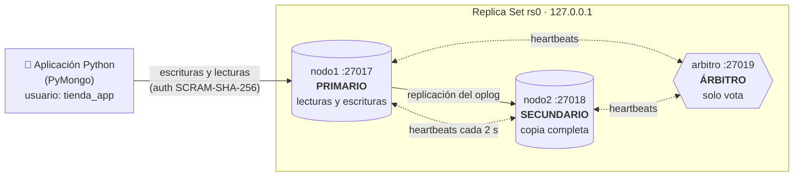
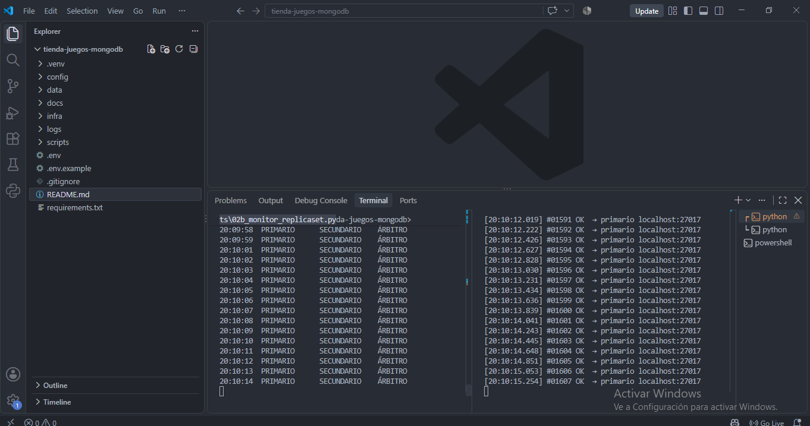
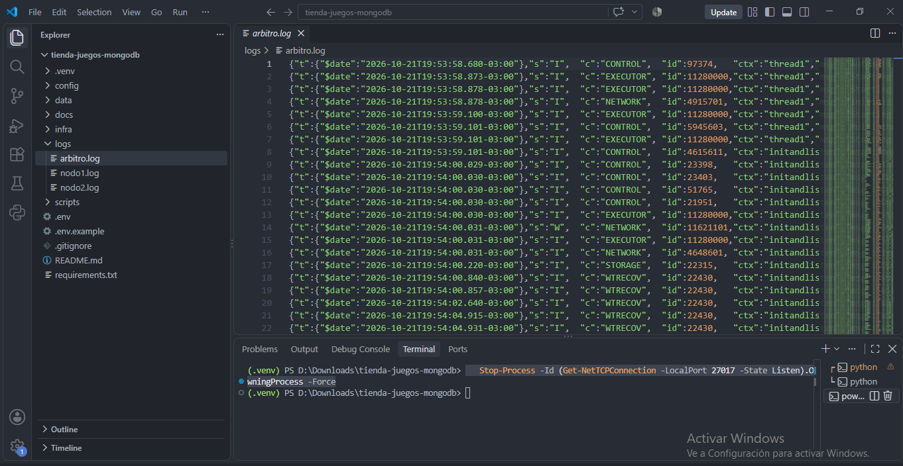
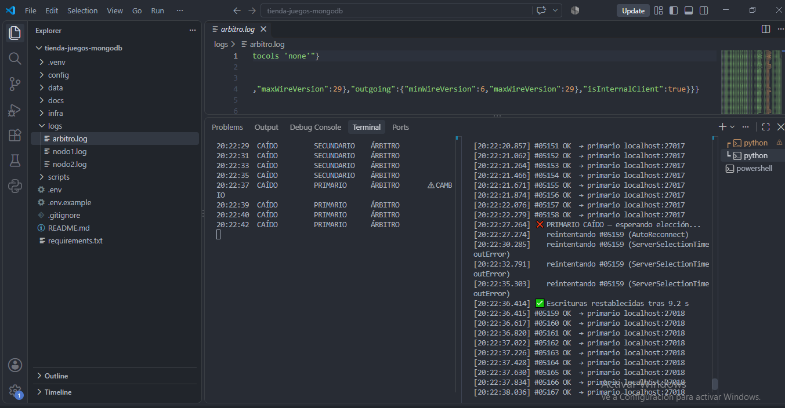

Base de datos de una tienda de videojuegos llevada de un `mongod` aislado a un **Replica Set de alta disponibilidad**, con **transacciones ACID multi-documento** para las compras y **autenticación obligatoria** con privilegios mínimos.

| | |
|---|---|
| **Motor** | MongoDB 7.0+ (Community) |
| **Lenguaje** | Python 3.10+ con PyMongo |
| **Topología** | Replica Set `rs0`: Primario + Secundario + Árbitro (PSA) |
| **Base** | `tiendaJuegos` (`usuarios`, `juegos`, `ordenes`) |

---

## Índice

1. [Diagrama de arquitectura](#1-diagrama-de-arquitectura)
2. [Estructura del repositorio](#2-estructura-del-repositorio)
3. [Puesta en marcha](#3-puesta-en-marcha)
4. [Paso 1 · Alta disponibilidad y bitácora del failover](#4-paso-1--alta-disponibilidad-y-bitácora-del-failover)
5. [Paso 2 · Transacciones ACID](#5-paso-2--transacciones-acid-multi-documento)
6. [Paso 3 · Reporte de securización](#6-paso-3--reporte-de-securización)
7. [Conclusiones](#7-conclusiones)

---

## 1. Diagrama de arquitectura



**Cómo se distribuyen los datos.** Toda escritura entra por el **primario** y queda registrada en su *oplog* (un log de operaciones). El **secundario** lee ese oplog continuamente y reaplica las operaciones, así mantiene una **copia completa** de `tiendaJuegos`. El **árbitro no guarda datos**: solo participa con su voto en las elecciones.

**Por qué hace falta el árbitro.** Para elegir un primario se necesita **mayoría de votos** (2 de 3). Si cae el primario, el secundario solo tiene su propio voto. El árbitro aporta el segundo y permite la promoción. Con apenas dos nodos, la caída de uno dejaría al otro sin mayoría y la base quedaría en solo lectura.

**Cómo encuentra el primario la aplicación.** La aplicación se conecta al *Replica Set* (`replicaSet=rs0`), no a un nodo fijo. El driver descubre la topología, envía las operaciones al primario de turno y, tras un failover, se redirige solo al nuevo primario.

---

## 2. Estructura del repositorio

```
├── config/
│   ├── inicial/               # mongod.conf de cada nodo, sin autenticación (Pasos 1 y 2)
│   └── seguro/                # mismos archivos + security.authorization (Paso 3)
├── infra/
│   ├── iniciar-nodos.sh|.ps1  # levanta los 3 mongod (Linux/macOS | Windows)
│   └── detener-nodos.sh|.ps1
├── scripts/
│   ├── config.py                    # conexión compartida (lee .env)
│   ├── 00_init_replicaset.py        # crea el Replica Set PSA
│   ├── 01_seed.py                   # colecciones, validadores, índices y datos
│   ├── 02_failover_insert_loop.py   # inserción continua para la prueba de caída
│   ├── 02b_monitor_replicaset.py    # muestra el rol de cada nodo en vivo
│   ├── 03_transaccion_compra.py     # transacción ACID: éxito y rollback
│   ├── 04_crear_usuarios.py         # admin + usuario de aplicación
│   ├── 05_verificar_seguridad.py    # auditoría automática de permisos
│   └── generar_keyfile.py           # clave interna entre nodos
├── docs/img/                  # capturas de la bitácora
├── .env.example
└── requirements.txt
```

---

## 3. Puesta en marcha

**Requisitos:** MongoDB Server 7.0+ con `mongod` en el PATH, y Python 3.10+.

> **Windows:** el instalador de MongoDB crea un servicio que ya ocupa el puerto 27017. Detenelo antes de empezar con `net stop MongoDB` en una consola de administrador. Si `mongod` no se reconoce como comando, agregá `C:\Program Files\MongoDB\Server\<versión>\bin` al PATH.

```bash
pip install -r requirements.txt
cp .env.example .env                       # Windows: copy .env.example .env

./infra/iniciar-nodos.sh inicial           # Windows: .\infra\iniciar-nodos.ps1 inicial
python scripts/00_init_replicaset.py
python scripts/01_seed.py
```

Todos los comandos se ejecutan **desde la raíz del repositorio**.

---

## 4. Paso 1 · Alta disponibilidad y bitácora del failover

### Procedimiento

Se usan dos terminales:

| Terminal A | Terminal B |
|---|---|
| `python scripts/02b_monitor_replicaset.py` | `python scripts/02_failover_insert_loop.py` |

Con las inserciones corriendo, se mata el proceso del primario con el PID que muestra el monitor:

```bash
kill -9 <PID_nodo1>                      # Linux / macOS
Stop-Process -Id <PID_nodo1> -Force      # Windows
```

Se usa `kill -9` (y no un apagado ordenado) a propósito: emula un corte de luz o un crash, donde el nodo **no avisa** que se va.

### Bitácora

> 📸 Reemplazar cada captura por la propia, guardada en `docs/img/`.

**① Estado inicial.** `nodo1` es primario y todas las inserciones van a `localhost:27017`.



**② Caída del primario.** Tras el `kill -9`, el monitor marca `nodo1` como `CAÍDO` y el script de inserción empieza a fallar con `AutoReconnect` / `ServerSelectionTimeoutError`. No hay primario, así que nadie puede aceptar escrituras.



**③ Votación.** `nodo2` deja de recibir los *heartbeats* de `nodo1`. Pasado el `electionTimeoutMillis` (10 s por defecto), se postula como candidato y pide votos. Vota por sí mismo, el **árbitro le da el segundo voto** y así reúne 2 de 3, la mayoría. En `logs/nodo2.log` aparecen mensajes como `Starting an election` y `Election succeeded, assuming primary role`.



**④ Nuevo primario.** El monitor muestra `nodo2` como `PRIMARIO` (marcado con ⚠ CAMBIO) y el script informa `Escrituras restablecidas tras X s`. Las inserciones siguen, ahora hacia `localhost:27018`, **sin reiniciar la aplicación**.


### Resultados

| Métrica | Valor medido |
|---|---|
| Tiempo sin primario | _completar (normalmente 10–12 s)_ |
| Inserciones exitosas | _completar_ |
| Secuencias perdidas (`--verificar`) | _completar_ |

### Decisión técnica: write concern en topología PSA

El *write concern* define cuántos nodos deben confirmar una escritura antes de darla por hecha.

- Con **`w: "majority"`** hacen falta 2 nodos **con datos**. El árbitro no cuenta porque no guarda datos. Si cae un nodo con datos, queda uno solo y las escrituras **se bloquean** hasta que el otro vuelva. Eso frustraría la prueba de alta disponibilidad.
- Por eso `00_init_replicaset.py` fija **`w: 1` como default del clúster** y el script de inserción lo usa explícitamente.

El costo de esa elección es real. Una escritura confirmada con `w: 1` que el primario no alcanzó a replicar antes de morir se **revierte** (*rollback*) cuando ese nodo vuelve. MongoDB guarda esas escrituras en la carpeta `rollback/` del nodo. `02_failover_insert_loop.py --verificar` detecta esos huecos en la secuencia.

En resumen: **los datos críticos (las compras) usan `majority`** y aceptan esperar. Los datos de baja criticidad usan `w: 1` y priorizan la disponibilidad. En producción, la solución es reemplazar el árbitro por un tercer nodo con datos (topología PSS).

---

## 5. Paso 2 · Transacciones ACID multi-documento

### El proceso de negocio

Una **compra** toca tres documentos en tres colecciones distintas, y la base nunca puede quedar a medio camino:

| # | Colección | Operación | Si quedara sola… |
|---|---|---|---|
| 1 | `juegos` | `stock - 1` | Se pierde una unidad sin venta registrada |
| 2 | `ordenes` | nueva orden | Se entrega un juego que nadie pagó |
| 3 | `usuarios` | `saldo - precio` | Se cobra sin entregar nada |

### Código (`scripts/03_transaccion_compra.py`)

El núcleo, resumido (el script completo está comentado línea por línea):

```python
with client.start_session() as session:
    session.start_transaction(
        read_concern=ReadConcern("snapshot"),               # foto consistente
        write_concern=WriteConcern("majority", wtimeout=5000),  # durable ante un failover
    )
    try:
        juego = db.juegos.find_one_and_update(                # 1. descontar stock
            {"titulo": titulo, "stock": {"$gt": 0}},
            {"$inc": {"stock": -1}}, session=session, ...)

        db.ordenes.insert_one(orden, session=session)         # 2. crear orden

        res = db.usuarios.update_one(                          # 3. cobrar
            {"_id": usuario["_id"], "saldo": {"$gte": juego["precio"]}},
            {"$inc": {"saldo": -juego["precio"]}}, session=session)
        if res.matched_count == 0:
            raise ReglaDeNegocioError("Saldo insuficiente")    # regla violada a mitad de camino

        session.commit_transaction()                           # todo o…
    except Exception:
        session.abort_transaction()                            # …nada
        raise
```

Puntos clave del manejo de sesiones y errores:

- **`session=session` en cada operación.** Una operación sin la sesión se ejecuta **fuera** de la transacción y no se revertiría.
- **La regla de negocio vive en el filtro.** `saldo >= precio` hace que el `update` no encuentre documento cuando no alcanza el saldo. No hay una lectura previa que pueda quedar desactualizada.
- **Reintentos solo de errores transitorios.** Si MongoDB marca un error con `TransientTransactionError` (por ejemplo, un failover en plena compra), se reintenta la transacción completa. Si un commit falla con `UnknownTransactionCommitResult`, se reintenta solo el commit, que es idempotente. Los errores de negocio **nunca** se reintentan.
- **Defensa en profundidad.** Los validadores `$jsonSchema` de `01_seed.py` impiden a nivel del motor un `stock` o `saldo` negativos, aunque el código tuviera un error.

### Escenario de éxito: commit

Ana (saldo $50.000) compra *Hollow Knight* ($15.000):

```
═══ ESCENARIO DE ÉXITO: ana@mail.com compra 'Hollow Knight' ═══
  ANTES    saldo=$ 50,000  stock=10  ordenes=0
  1) Stock descontado dentro de la transacción → 9
     (una lectura FUERA de la transacción todavía ve stock = 10)
  2) Orden creada dentro de la transacción → 6717...
  3) Saldo descontado: $15,000
  ✅ commit_transaction(): los 3 cambios quedaron confirmados
  DESPUÉS  saldo=$ 35,000  stock= 9  ordenes=1
  ✔ Commit verificado: stock, orden y saldo cambiaron juntos.
```

### Escenario de fallo provocado: rollback

Bruno (saldo $5.000) intenta comprar el mismo juego. Los pasos 1 y 2 **ya se ejecutaron** cuando el paso 3 detecta el saldo insuficiente:

```
═══ ESCENARIO DE FALLO: bruno@mail.com compra 'Hollow Knight' ═══
  ANTES    saldo=$  5,000  stock= 9  ordenes=1
  1) Stock descontado dentro de la transacción → 8
     (una lectura FUERA de la transacción todavía ve stock = 9)
  2) Orden creada dentro de la transacción → 6717...
  ⛔ abort_transaction() → Saldo insuficiente: Bruno tiene $5,000 y el juego cuesta $15,000
  DESPUÉS  saldo=$  5,000  stock= 9  ordenes=1
  ✔ Rollback verificado: la base quedó intacta.
```

> 📸 Reemplazar por la salida real: `docs/img/05-transaccion.png`

### Las cuatro propiedades ACID, demostradas

| Propiedad | Evidencia en la ejecución |
|---|---|
| **Atomicidad** | En el fallo, el stock descontado y la orden insertada se revierten juntos |
| **Consistencia** | Nunca existe una orden sin cobro ni stock negativo (filtros + validadores) |
| **Aislamiento** | Durante la transacción, una lectura externa sigue viendo `stock = 10` |
| **Durabilidad** | El commit con `w: "majority"` queda en ambos nodos con datos y sobrevive a un failover |

> Las transacciones multi-documento **requieren un Replica Set**: sobre un `mongod` aislado fallan. Por eso este paso se apoya en el Paso 1.

---

## 6. Paso 3 · Reporte de securización

### El problema histórico

Desde finales de 2016, decenas de miles de servidores MongoDB expuestos en internet fueron vaciados y "secuestrados": los atacantes borraban los datos y dejaban una nota pidiendo un rescate en bitcoins. No explotaron ninguna vulnerabilidad del código. Aprovecharon **configuraciones por defecto**:

1. **Autenticación desactivada.** Cualquiera que llegara al puerto 27017 tenía control total.
2. **Escucha en todas las interfaces.** Las versiones antiguas aceptaban conexiones desde cualquier IP (`0.0.0.0`). Desde la 3.6 el default es `localhost`, pero muchos administradores lo abrían para "que funcione".

### Medidas aplicadas

| Medida | Configuración | Qué cierra |
|---|---|---|
| Autorización obligatoria | `security.authorization: enabled` | Ninguna operación sin usuario y contraseña |
| Escucha solo local | `net.bindIp: 127.0.0.1` | El puerto no es alcanzable desde la red |
| Autenticación interna | `security.keyFile` | Un `mongod` ajeno no puede unirse al Replica Set ni recibir réplicas |
| Privilegios mínimos | roles abajo | Una credencial robada de la app no compromete el resto |
| Secretos fuera del repo | `.env` y `secrets/` en `.gitignore` | Las contraseñas no quedan publicadas en GitHub |

### Roles creados

| Usuario | Rol | Alcance | Uso |
|---|---|---|---|
| `admin` | `root` | Todo el clúster | Solo administración: alta de usuarios y mantenimiento. La aplicación **nunca** lo usa. |
| `tienda_app` | `readWrite` | Solo `tiendaJuegos` | Usuario de la aplicación: lee y escribe sus datos. No puede ver otras bases, crear usuarios, borrar la base ni administrar el clúster. |

Si alguien roba la contraseña de `tienda_app`, el daño queda acotado a los datos de la tienda. No puede crear un usuario propio para persistir ni borrar la base completa (`dropDatabase` requiere `dbAdmin`), y tampoco puede tocar otras bases del servidor.

### Procedimiento

```bash
python scripts/04_crear_usuarios.py          # 1. crear usuarios (aún sin auth)
python scripts/generar_keyfile.py            # 2. clave interna entre nodos
./infra/detener-nodos.sh                     # 3. reiniciar en modo seguro
./infra/iniciar-nodos.sh seguro
python scripts/05_verificar_seguridad.py     # 4. auditoría
```

A partir de acá, los scripts 01–03 necesitan `MONGO_USER=tienda_app` y `MONGO_PASS` en el `.env`. Los datos y la configuración del Replica Set se conservan: solo cambian las reglas de acceso.

### Evidencia: rechazo del acceso anónimo

`05_verificar_seguridad.py` prueba cada tipo de acceso y lo compara con lo esperado:

```
Prueba                       Esperado   Obtenido      Respuesta del servidor
──────────────────────────────────────────────────────────────────────────────
Anónimo lee juegos           DENEGADO   DENEGADO   ✅  [13] Command find requires authentication
Anónimo lista las bases      DENEGADO   DENEGADO   ✅  [13] Command listDatabases requires authentication
Anónimo inserta datos        DENEGADO   DENEGADO   ✅  [13] Command insert requires authentication
Contraseña incorrecta        DENEGADO   DENEGADO   ✅  [18] Authentication failed.
App lee juegos (su base)     PERMITIDO  PERMITIDO  ✅  {'_id': ObjectId(...), 'titulo': ...
App escribe en su base       PERMITIDO  PERMITIDO  ✅  True
App escribe en OTRA base     DENEGADO   DENEGADO   ✅  [13] not authorized on otraBase to ...
App lista bases (solo la suya) PERMITIDO PERMITIDO ✅  ['tiendaJuegos']
App crea un usuario          DENEGADO   DENEGADO   ✅  [13] not authorized on tiendaJuegos ...
App borra la base completa   DENEGADO   DENEGADO   ✅  [13] not authorized on tiendaJuegos ...
Admin lista las bases        PERMITIDO  PERMITIDO  ✅  ['admin', 'config', 'local', 'tienda...
```

> 📸 Reemplazar por la salida real: `docs/img/06-auditoria-seguridad.png`. Conviene sumar una captura de `mongosh` sin credenciales ejecutando `db.juegos.find()` y recibiendo `requires authentication`.

### ¿Por qué esta base es inmune a esos ataques?

El ataque de 2016–2017 necesitaba dos cosas: **llegar al puerto** y **operar sin credenciales**. Esta instalación niega ambas en capas independientes:

- `bindIp: 127.0.0.1` impide llegar al puerto desde la red.
- Aunque alguien llegara, `authorization: enabled` rechaza toda operación anónima con el error 13. El script lo prueba.
- Aunque obtuviera la credencial de la aplicación, el principio de privilegios mínimos le impide borrar la base o crear accesos propios.
- El `keyFile` impide que un nodo falso se sume al Replica Set para recibir una copia de los datos.

Para un despliegue real fuera de `localhost` habría que sumar **TLS** (`net.tls`) para cifrar el tráfico, un firewall que limite el puerto a las IPs de la aplicación y backups periódicos.

---

## 7. Conclusiones

- **Disponibilidad.** Ante la caída abrupta del primario, el clúster eligió un nuevo primario en segundos y la aplicación siguió escribiendo sin intervención manual.
- **Consistencia.** Las compras son atómicas: un fallo a mitad del proceso no deja rastro en ninguna de las tres colecciones.
- **Seguridad.** La base rechaza todo acceso anónimo y la aplicación opera con el mínimo privilegio necesario.
- **Trade-off consciente.** La topología PSA es económica pero obliga a elegir entre disponibilidad de escritura y durabilidad. Este proyecto documenta esa decisión por tipo de dato, y la migración natural es a PSS.
